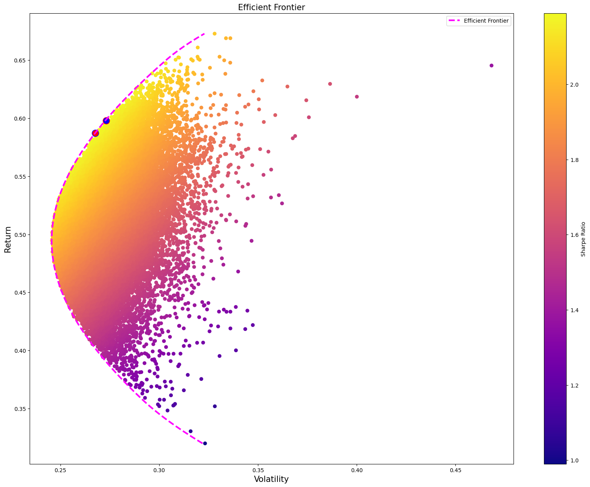

# Tse Portfolio Optimization (MPT)

Portfolio optimization of selected Tehran Stock Exchange (TSE) stocks using Modern Portfolio Theory (MPT), Monte Carlo simulation, and SciPy-based optimization.

All data is retrieved dynamically from TSE via the [finpy_tse] library.  
The project is fully contained in a single Jupyter Notebook.

---

## 📈 Stocks Analyzed

The portfolio consists of the following six actively traded stocks:

- دکپسول
- فولاد
- ثشرق
- سپیدار
- سصوفی
- تپسی

---

## 🗂️ Project Workflow

The notebook follows these steps:

1. **Data Collection:** Fetches historical prices from TSE using `finpy_tse`
2. **Preprocessing:** Cleans data, reindexes, calculates returns
3. **Exploratory Analysis:** Normalizes prices for visualization
4. **Random Portfolio:** Randomly generates portfolio weights (Monte Carlo simulation)
5. **Simulation:** Simulates thousands of portfolios to analyze distribution of risk/return/Sharpe
6. **Risk/Return Calculation:** Calculates volatility, expected return, and Sharpe ratio
7. **Optimization:** Maximizes Sharpe ratio using `scipy.optimize` (`SLSQP` method)
8. **Efficient Frontier:** Constructs and visualizes the set of optimal risk–return portfolios
9. **Results Visualization:** Plots portfolios, efficient frontier, and highlights the optimal portfolios

---

## 🚦 Efficient Frontier Example

---

## 🛠️ Libraries Used

- numpy
- pandas
- matplotlib
- plotly
- scipy
- finpy-tse
- jupyter

---

## 📊 Output

- Normalized price line plots
- Scatter plot of portfolios (risk/return/Sharpe)
- Efficient frontier with highlighted maximum Sharpe and minimum volatility portfolios
- Tabular summary of portfolio weights, expected return, risk, and Sharpe ratio

---

## ⚠️ Disclaimer

This project is for educational and research purposes only.  
No content or results represent financial advice or a recommendation to invest or trade.

---

## 📝 License

[MIT](LICENSE)
